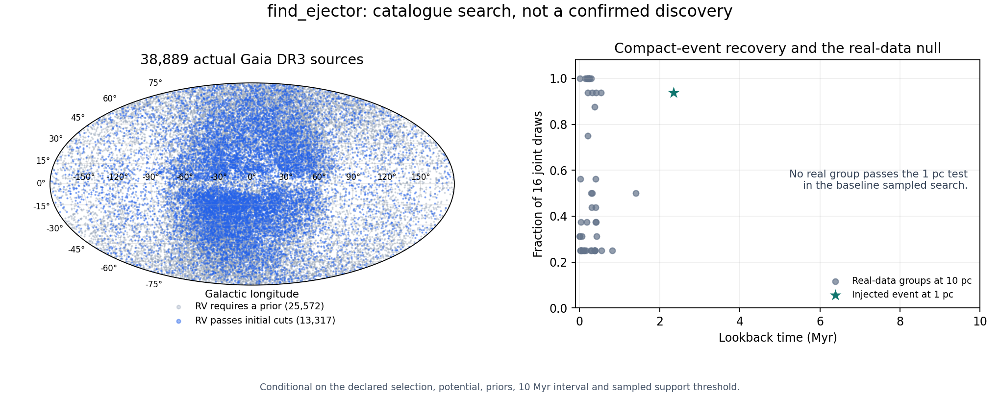

# `find_ejector`: the real Gaia catalogue campaign

**A working catalogue search, with no confirmed new ejector and no claim of
full-objective completion.** The implementation searches 38,889 actual Gaia
DR3 sources, retains every usable source, and finds encounters between orbit
snapshots. Its blind full-background injection recovers a 2.345 Myr ejection
and its supplied moving source. The real-data candidates do not establish an
ejection discovery.

The stronger 1 pc search returns **zero real groups** in the baseline, broader
missing-RV prior, longer distance prior, and measured-RV-only runs, at the
specified sampled-support threshold; the heavier-Galaxy run also returns zero. The synthetic injection still passes at
1 pc with 15/16 draws. These are conditional results for this selection,
10 Myr interval, potential and sampled uncertainty; they are not an exclusion
of ejectors in the Galaxy.

**Follow-up:** the [observation-space encounter fitter](../ejector_fit/README.md)
recovers a compatible historical Orion triple even when a 16-draw, 25%-support
search reports no group. The zero counts above must not be read as physical
exclusions: small sampled support and the >400 km/s selection both limit
recovery. The new work also tests distinct launch times from one shared source.



[Machine-readable campaign summary](results/campaign.json) · [All-source traceback overview](results/traceback-overview.npz)

## What was actually searched

The archive query in [gaia_query.adql](data/gaia_query.adql) selects:

- positive parallax > 0.15 mas and parallax/error > 10;
- RUWE < 1.4 and `duplicated_source = false`;
- heliocentric tangential speed `4.74047 * hypot(pmra,pmdec) / parallax > 400`
  km/s **or** absolute reported radial velocity > 400 km/s.

This is an all-sky **declared selection**, not a complete census of fast stars.
It excludes lower-speed runaways and weak-parallax sources, is not a total
Galactocentric-speed selection, and does not establish that a selected source
is unbound. The OR selection also misses some objects whose combined
heliocentric speed exceeds 400 km/s but neither component does.

An anonymous whole-sky TAP query exceeded the archive's 60-second limit. The
successful download divides the complete Gaia source-ID domain into 192
nonoverlapping ranges. There is no `TOP` clause. Every VOTable has successful
QUERY_STATUS and no OVERFLOW. All partitions, row counts and hashes are in
[download_manifest.json](data/download_manifest.json); the merged raw data are
[gaia_fast.fits.gz](data/gaia_fast.fits.gz). **38,889 unique rows were downloaded
and all 38,889 passed the astrometric-likelihood checks.**

The initial RV checks admit 13,317 reported measurements; 25,572 sources use
an explicitly labeled Gaussian heliocentric RV prior. Passing those initial
checks does not independently validate an extreme Gaia RV. The candidate-level
spectral S/N audit below is essential.

## Actual web-repo data

[web_audit.json](data/web_audit.json) records web commit
`6c1bd47af192bd46e62453f88caa07fe5bea33d8` and the original file hash.

The checked-in `rogue-planets/gaia_field.fits` contains **162 real sources in
one Ophiuchus field**, without uncertainties, correlations or radial velocities.
It is not the 169,000-star pool discussed on the web stars page; that underlying
pool is absent from this checkout. Treating the file's positions as exact or
filling its missing velocities with zero would be scientifically wrong.

We retrieved the **same 162 IDs**, with full Gaia likelihood columns, and
verified exact ID equality. [web_field_enriched.vot](data/web_field_enriched.vot)
and its ADQL query preserve that enrichment. Four sources lack usable
astrometric likelihoods and are explicitly excluded; **158 were traced**.
This crowded-field validation produces 1,153 proximity groups at R=1 pc over
0--3 Myr, emphasizing that proximity is not ejection. It is not a fast-star
science sample. Both web-dossier stars, Gaia DR3 4444484419062859520 and
3730655773522657152, are included in the separate all-sky selection.

## Search and uncertainty

The [implementation guide](../../docs/find-ejector-catalogue.md) gives the
schema and the completeness argument. The main experiments use:

- all 38,889 sources, or the explicitly identified 13,317-RV subset;
- 16 joint draws, including Gaia's full five-parameter correlation matrix,
  an explicit distance prior and a shared parallax-calibration draw;
- triples, with every member within 10 pc of its arithmetic centroid in at
  least 4/16 simultaneous draws;
- 0--10 Myr, with output spacing 0.1 Myr and integration step 0.05 Myr;
  the searched trajectories use half that integration step;
- complete continuous-time searches of the piecewise-linear paths, with all
  qualifying groups and every disjoint qualifying interval retained;
- complete float64 traceback archives, independent of whether a star enters
  any candidate group.

The baseline has **48** qualifying triples at 10 pc; the measured-only run has
**28**. Doubling the missing-RV prior width from 300 to 600 km/s gives **39**;
changing the distance-prior scale from 1.35 to 5 kpc gives **48**. Increasing
all potential force amplitudes by 20% and the solar azimuthal velocity by
10 km/s also gives **48**, with zero 1 pc groups. These sensitivity
choices are not a fitted Galactic population posterior.

The baseline evaluates 453 eligible group/segment combinations after conservative
pair gating. It does not enumerate the roughly 9.8 trillion possible triples
at every time. The gate is necessary for the stated event, not a ranked shortlist.
Maximum baseline coarse/fine position difference is **0.0187 pc**, and maximum
checked midpoint deviation from the interpolation chord is **0.0688 pc**.
The latter is a diagnostic, not a certified bound on all exact-flow errors.

At smaller R, every qualifying group must already have qualified at the larger
R. [tighten_radius.py](tighten_radius.py) uses that monotonicity to rescan the
complete parent catalogue through its candidate-member union, retaining the
same draws, paths, support threshold and time interval. This is why the 1 pc
results still cover the entire declared catalogue. Larger-radius control
rank fractions are **not** transferred to the tighter-radius search.

## Why the apparent detections are not discoveries

The highest-ranked measured-RV groups have origins close to the Sun's past
location. Selecting nearby stars with extreme positive radial velocities can
produce such a pattern, especially when velocities are erroneous. The full
search therefore tests both velocity-cloud permutation and a control that
preserves each star's radial velocity and speed while rotating its tangential
motion. Neither null is a calibrated Galactic population model. A small rank
fraction is not an astrophysical false-discovery probability, and multiple
scenario/radius choices add further selection.

All 25 distinct sources in the 28 measured-RV groups were retrieved again with
spectroscopic quality fields; see [candidate_rv_quality.vot](data/candidate_rv_quality.vot)
and its saved query. **26 groups contain at least one source with Gaia expected
RV S/N < 5.** This is a quality failure requiring independent spectroscopy, not
proof that every such reported velocity is wrong. A SIMBAD identity/RV check is
also saved. Most returned velocities cite Gaia itself and are not independent
confirmation.

The other two groups both contain the close co-moving pair **G 266-60/61**
(Gaia DR3 2364812051194680448 and 2364812055490127488). Treating those components
as independent ejection paths overstates the information. A targeted 512-draw
refinement gives:

| Third star | Closest approach to pair center, median [16%, 84%] | Median lookback |
| --- | --- | --- |
| Gaia DR3 6395326738923518976 | 11.0 [9.0, 14.0] pc | 0.527 Myr |
| Gaia DR3 4979220221218050432 | 14.3 [11.2, 18.4] pc | 1.396 Myr |

Neither approaches within 1 pc in any of those 512 draws, and no triple passes
the refined 1 pc search. The two 10 pc groups retain high sampled support, but
the inferred geometry is a nearby passage, not evidence of a compact ejection.
Targeted controls, including a shared rotation for the pair, give a minimum
rank fraction of 1/32. **That is post-selection, four-source inference and must
not be represented as global significance.** The original whole-catalogue
control results are retained separately.

## Positive recovery and independent checks

Three synthetic stars with a shared origin at 2.345 Myr were added to the
**entire real 38,889-source background**, without identifying their members to
the search. Each has nonzero position and velocity uncertainty. The recovered
peak is **2.344986 Myr**, the origin is within a fraction of a parsec of the
injection, and the supplied moving source is associated in all accepted draws.
The injection is the sole additional group (49 instead of 48), and remains the
only group in the 1 pc rescan with support 15/16. This is an injection validation,
not an observed discovery or a measured completeness function over all signals.

Tests also compare the search with exhaustive small-catalogue calculations,
exercise crossings invisible at all stored epochs, reject pairs that meet at
different times, compare orbit integration to independent DOP853 solutions,
preserve correlated Gaia likelihoods and shared calibration, verify control
invariants, check tighter-radius completeness, and validate the archived query.

[identifiability.py](identifiability.py) gives an exact, independently checked
missing-RV ambiguity: two different common origins/ages can produce identical
perfect 5D astrometry. This is established kinematics, not a claimed new theorem.
It demonstrates why a velocity prior cannot become a measurement by increasing
computing power.

## Reproduce

From the repository root after installing `.[test]`, all searches run offline
against the committed raw catalogue. Use new output directories. Full archives
require about **3 GB per 38,889-source, 16-draw run**; the packaged overview is
much smaller. CPU time depends on scenario and controls and can be tens of
minutes. Set `OPENBLAS_NUM_THREADS=1` when running several experiments.

```bash
export OPENBLAS_NUM_THREADS=1
python research/ejector_catalogue/run.py --output /tmp/ejector/final-baseline --controls 3
python research/ejector_catalogue/run.py --output /tmp/ejector/final-measured --scenario measured_rv --controls 19
python research/ejector_catalogue/run.py --output /tmp/ejector/final-broad-rv --scenario broad_rv
python research/ejector_catalogue/run.py --output /tmp/ejector/final-long-distance --scenario long_distance
python research/ejector_catalogue/run.py --output /tmp/ejector/heavy-galaxy --scenario heavy_galaxy
python research/ejector_catalogue/run.py --output /tmp/ejector/measured-radial-control --scenario measured_rv --controls 7 --control-method tangent_rotation
python research/ejector_catalogue/run.py --output /tmp/ejector/full-injection --scenario injection
python research/ejector_catalogue/run.py --data research/ejector_catalogue/data/web_field_enriched.vot --output /tmp/ejector/web-field-final --radius 1 --lookback 3 --step .1 --integration-step .01 --controls 3
python -m research.ejector_catalogue.refine /tmp/ejector/final-measured/result.json /tmp/ejector/quality-refinement
python -m research.ejector_catalogue.followups /tmp/ejector
python research/ejector_catalogue/summarize.py /tmp/ejector NEW_RESULTS_DIRECTORY
python -m pytest -q
```

The posterior generator also has a production CLI, `constellation ejector_prepare`;
the search is `constellation find_ejector` with a schema-2 manifest. See the guide
for complete examples. `fetch.py --output NEW_DIRECTORY` explicitly repeats the
live archive download with cached partition retries. It is not called by tests.

The results directory retains full candidate summaries, the source inclusion/RV
ledger and compact all-source traceback percentiles. The overview contains
pointwise coordinate percentiles at 1 Myr spacing, **not individual physical
orbits or input for encounter searches**. Full float64 sampled paths at 0.1 Myr
spacing are regenerated by the commands above. A directory without
`tracebacks/complete.json` is an interrupted or failed run, even if its
preallocated array exists.

## Full-objective gaps and references

[OBJECTIVE.md](OBJECTIVE.md) preserves the full target. Missing are a complete
all-survey fused catalogue, validated source-dependent systematics and distance/
RV population models, sufficiently sampled full posteriors, a realistic
selection-aware false-association model, confirmed real-system recovery,
certified exact-flow coverage, and source-visibility completeness. The 100 Myr
software limit is not a claim to have searched 100 Myr: this campaign uses 10 Myr.
No dark source, IMBH or new physical ejector is claimed.

Traceback/common-origin inference predates this implementation:
[Hoogerwerf et al. (2001)](https://doi.org/10.1051/0004-6361:20000014).
Relevant Gaia work includes [Marchetti et al. (2022)](https://academic.oup.com/mnras/article/515/1/767/6620843),
[Scholz (2024)](https://arxiv.org/abs/2402.10714), and the spectroscopic assessment
[Gaia DR3 high radial velocity stars: Genuine fast-moving objects or outliers?](https://doi.org/10.1051/0004-6361/202556602).
The KD-tree, quadratic interval calculations, Gaussian conditioning and orbit
integrators use established methods; no mathematical novelty is claimed.

Data acknowledgments: ESA Gaia, the Gaia Data Processing and Analysis Consortium
([Gaia archive](https://gea.esac.esa.int/archive/)), and the
[SIMBAD database operated at CDS](https://simbad.cds.unistra.fr/).
