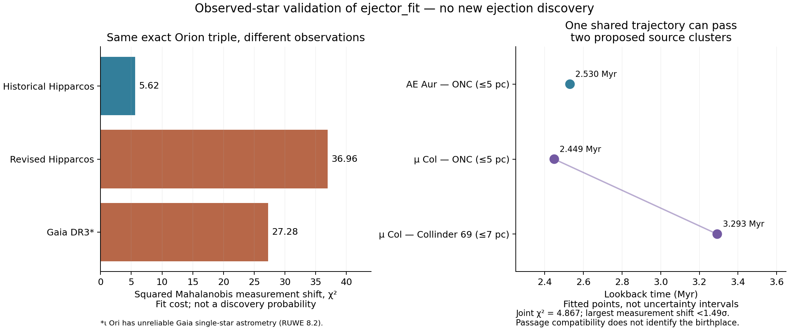

# Observed encounters, rare-event misses, and shared moving sources

**The fitter works on observed stars. No new astronomical discovery, new
mathematical breakthrough, or full `find_ejector` completion is claimed.**
This attempt tackles a real weakness in the preceding campaign: requiring
4 of 16 joint draws to converge can miss a compact encounter compatible with
the measurements. Raising a Monte Carlo hit threshold is not a reliable way to
exclude such encounters. The >400 km/s selection also excludes ordinary
runaways such as AE Aur and μ Col.

[`ejector_fit`](../../docs/ejector-fit.md) fits observations subject to Galactic
encounter constraints. It also fits several encounters at different times with
**one shared present-day state per object**. That makes it possible to test
repeated launches from a moving source and alternative birthplace passages
without giving each encounter a different version of the same object.

## Results that survived verification

1. **Historical Orion triple recovered.** With the published 1997 Hipparcos
   measurements in Hoogerwerf et al. (2001), the fit makes AE Aur, μ Col and
   ι Ori meet at **2.493253 Myr**. The Gaussian measurement cost is **χ²=5.6217**
   across twelve observables; the largest marginal measurement shift is
   **1.444σ**. All six age starts converge to the same solution. A separate
   DOP853 integration confirms the compact encounter within 0.00002 pc.
   This is an approximate historical benchmark: printed errors are treated as
   diagonal, angular positions are fixed, and our Galactic potential differs
   from the original paper. It is not an exact reproduction of that paper's
   inference or covariance treatment.
2. **A concrete Monte Carlo miss.** A reproducible 16-draw, 25%-support search
   over 0–6 Myr reports no 1 pc triple for those historical observations, while
   the constrained fit above supplies a compatible trajectory. This experiment
   uses a stated positive-parallax truncated Gaussian; it is neither the
   original paper's sampling scheme nor the preceding Gaia distance prior.
   Its purpose is to demonstrate that a sampled nondetection is not exclusion.
3. **One trajectory, two proposed source clusters.** A joint fit of AE Aur,
   μ Col, the Orion Nebula Cluster (ONC), and Collinder 69 produces three
   passages with **χ²=4.8666**, no active parameter bounds, and every marginal
   shift below **1.485σ**. All five starts converge. μ Col passes Collinder 69
   at **3.292625 Myr**, then the ONC at **2.448948 Myr**; AE Aur passes the ONC
   at **2.530315 Myr**. The respective allowed star–cluster separations are
   7, 5 and 5 pc. Every shared object has the same fitted state in all events.
   Independent integration confirms all three constraints to better than
   0.000004 pc beyond the specified boundaries. These are previously proposed
   associations: the new result here is a reproducible joint compatibility
   calculation, not a new identification or proof of ejection.

The third result makes the causal limitation concrete: the same measured star
can pass more than one plausible source. A close passage alone does not tell
us where it was launched. Bhat et al. (2022) already discussed an earlier
Collinder 69 origin for μ Col; this result must not be advertised as novel.



[All fit outcomes](results/campaign.json) ·
[Independent numerical validation](results/validation.json) ·
[Every input selection decision](results/manifests/selection_ledger.json)

## Harder attempts and failures

Updated observations change the historical triple substantially:

| Input measurements | Best fitted age (Myr) | Measurement χ² |
| --- | ---: | ---: |
| Hipparcos 1997, printed historical values | 2.4933 | 5.6217 |
| Hipparcos 2007, printed values in Bhat et al. | 2.6556 | 36.9636 |
| Gaia DR3 astrometry plus literature RVs | 2.4573 | 27.2840 |

These costs are not p-values or posterior probabilities. The Gaia ι Ori
single-star solution has **RUWE≈8.2** and is unreliable for a definitive
traceback; it is retained only in this explicitly labeled sensitivity
experiment. It is excluded from the broader quality-selected search. No
strong physical rejection is inferred from this comparison.

We took all **23** runaways in Bhat et al. Table A.1, obtained Gaia DR3
crossmatches, supplemented ι Ori from an explicit positional query, and
retained **18** with usable likelihoods and RUWE≤1.4. All 18 were fitted against
both the ONC and Collinder 69: **36 star–cluster hypotheses**, each with six
starting ages over 0.1–6 Myr. No high-speed >400 km/s cut was applied. Every
result is retained, including failed optimizations and fits requiring large
measurement shifts. Three low-cost passages recover the already proposed
AE Aur–ONC, μ Col–ONC and μ Col–Collinder 69 associations; this is not a
calibrated all-catalogue discovery search.

We also attempted a shared Collinder 69 orbit for **HIP 22061, HIP 29678 and
μ Col**, with distinct launch times. The 7 pc separation model, an exact
cluster-center model, and a +0.017 mas stellar-parallax sensitivity variant
are retained in the results. Optimizer failures are inconclusive and are not
certificates that these origins are impossible. Our fixed SIMBAD cluster
centroid, diagonal cluster errors, adopted kinematics and potential do not
reproduce every literature assumption.

Even μ Col alone illustrates why radius matters: fitting a passage within
**7 pc** of Collinder 69 gives χ²≈**0.443**, whereas forcing an encounter with
the adopted **exact center** gives a bound-active fit with χ²≈**75.63**.
The extended cluster association does not establish a compact common ejector.
We did not enlarge the encounter radii after seeing the failures.

## Reproduce

From the repository root, with the package installed:

```sh
constellation ejector_fit research/ejector_fit/data/hip1997_triple.json -o historical-fit.json
OPENBLAS_NUM_THREADS=1 python research/ejector_fit/run.py --output /tmp/ejector-fits --workers 3
OPENBLAS_NUM_THREADS=1 python research/ejector_fit/validate.py /tmp/ejector-fits
python research/ejector_fit/plot.py /tmp/ejector-fits
```

The campaign builds all manifests, preserves all individual optimizer trials,
and records input and implementation hashes. Every invocation reruns the fits.
The plotting step needs the
optional `matplotlib` package. Raw query replies and literature measurements
are committed; no network is required to reproduce the fits. Data are described
in [data/README.md](data/README.md). This new sample is public literature/Gaia
data, not the web repo's narrow Ophiuchus field; the preceding campaign's
[actual web-data audit](../ejector_catalogue/data/web_audit.json) remains separate.

## What remains unsolved

This addresses rare-event follow-up and shared-source consistency, not the
missing all-survey catalogue, global encounter enumeration, causal inference,
or selection-aware discovery calibration. The optimizer is local, the angles
are fixed, and frame/potential/calibration uncertainty is not jointly fitted.
Stellar ages, chemical membership, binaries, cluster structure and independent
spectroscopy are needed to distinguish launch from passage. A source match
needs historical and present-day visibility information; absence of a match
does not imply a dark object. The original
[completion requirements](../ejector_catalogue/OBJECTIVE.md) remain unmet.

The next scientifically justified target is **a full likelihood search with
realistic source populations and calibrated chance-passage controls**, using
independent RVs and cluster structure. More unvalidated compact-looking
solutions would not establish a breakthrough.

## Sources and prior work

- [Hoogerwerf, de Bruijne & de Zeeuw (2001)](https://arxiv.org/abs/astro-ph/0010057),
  Table 3: historical astrometry and velocities, including ι Ori's systemic RV.
- [Bhat, Irrgang & Heber (2022)](https://arxiv.org/abs/2204.01594), Tables A.1,
  A.2 and discussion: updated astrometry, RVs, cluster kinematics, encounter
  minimization, and competing origins. The fitting concept is established work.
- [Gaia archive](https://gea.esac.esa.int/archive/): stored DR3 responses,
  within-star parallax/proper-motion correlations, and quality indicators.
- [SIMBAD](https://simbad.cds.unistra.fr/): stored cluster angular centroids.
