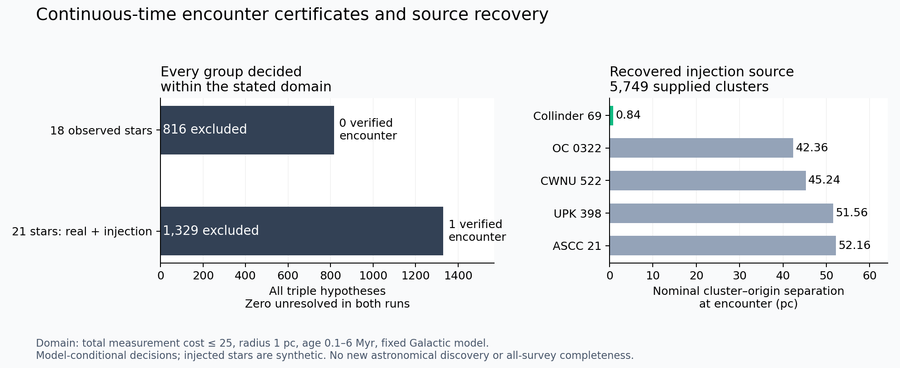

# A complete bounded encounter decision on real data

The new interval solver **decides all 816 triples in an observed 18-star
catalogue**, excluding a common 1 pc origin at every time from 0.1 to 6 Myr
within total measurement cost C ≤ 25 and the fixed supplied Galactic model.
This conclusion covers continuous observation domains and continuous ODE
trajectories. It is stronger than a failed optimizer or a Monte Carlo non-detection.

The same machinery certifies an encounter for the historical Orion triple and
recovers an unknown injected triple in real background data, excluding every
other triple in that recovery catalogue. These are **completed finite decision
problems**. The original all-survey `find_ejector` objective remains incomplete;
there is no new astronomical discovery or new mathematical theorem here.

## Results

| Input | All triple hypotheses | Interval exclusions | Certified compatible groups | Unresolved |
| --- | ---: | ---: | ---: | ---: |
| 18 observed literature runaways with usable Gaia astrometry | 816 | 816 | 0 | 0 |
| Same 18 observed stars + 3 noisy synthetic ejecta, shuffled | 1,330 | 1,329 | 1 | 0 |
| Historical observed AE Aur / iota Ori / mu Col measurements | 1 | 0 | 1 | 0 |



The historical existence witness has total cost **5.622**, age **2.493253 Myr**,
and a certified centroid-radius upper bound of **0.002005 pc**, well inside the
1 pc question. It uses the printed historical measurements and diagonal
uncertainties from Hoogerwerf et al. (2001), not a claim that updated data confirm
the same birthplace. Iota Ori's poor Gaia fit excludes it from the primary
18-star sample; there is no contradiction between these two input datasets.

The blinded injection is found among all 1,330 groups. Its existence witness has
cost **1.654**, age **2.339832 Myr** versus a true injected age of **2.345 Myr**,
and radius bound below **0.001879 pc**. Observation noise accounts for the fitted
age shift. The ordinary finite-radius profile fit gives 2.336795 Myr and cost
0.1386; these are different compatible witnesses, not conflicting truth labels.

The injection's source is correctly matched to **Collinder 69** among **5,749**
published clusters with usable nominal 6D states. The profile-fit origin is
0.84 pc from its propagated cluster center; the next nearest supplied cluster
is 42.36 pc away. The interval-verified witness also has source comparisons in
its certificate. This validates the detection-to-source workflow for a known
synthetic truth; it is not an observed ejection discovery.

## What was built and tested

[`ejector_search`](../../docs/ejector-search.md) fits **every combination**, with
three declared starting ages, archives every outcome, and repeats the entire
search on 19 proper-motion rotation controls. The 18-star campaign therefore
contains **16,320 group fits** across 20 catalogues. All failed fits are retained;
the single converged observed group has cost about 288.65 and fails C ≤ 25.

The historical positive control uses 99 whole-search rotations. Its finite-radius
profile cost is 3.9325, and its control rank is 0.01. **That rank is not an
astrophysical false-alarm probability.** Literature runaway selection and a real
Galactic velocity field do not satisfy the simple uniform-direction null. We
have not converted this diagnostic into a discovery claim.

[`ejector_bound`](../../docs/ejector-search.md) encloses continuous trajectories
with Arb ball arithmetic and Picard inclusion. Coarse outer tubes exclude 789
of the 816 observed groups. Subdivision of the remaining 27 measurement domains
discharges every branch, using **497 branch nodes** in total. These exclusions
do not depend on the optimizer finding a global minimum. The recovery sample
likewise has all groups decided, with one positive existence certificate.

The bounds use the exact supplied covariance matrix, marginal outer boxes, and
latent-coordinate subdivisions with interval Cholesky factors. They relax the
fitter's per-coordinate `max_sigma` restrictions. A failed enclosure becomes an
unbounded outer set; a node limit leaves pending domains unresolved. A positive
certificate requires interval verification of both cost and physical trajectory.

The [verifier](verify.py) replays the enclosures, refinements and positive
witnesses. It separately checks the branch partitions with **exact rational
volumes and disjoint interiors**, verifies every group is accounted for, and
checks input/code hashes. Tests compare interval tubes against independent
DOP853 trajectories, retain encounters between time endpoints, reject damaged
witnesses, and ensure failed enclosures/capped searches cannot certify exclusion.

## Data and source coverage

The primary stars are the same 18 valid Gaia DR3 matches from the previous
[23-object literature sample](../ejector_fit/README.md): all 816 triples are
searched, without selecting a target trio. The previous raw Gaia responses,
RV transcriptions, references and quality ledger remain in that campaign.
This sample comes from public observations and literature, **not** the small
Ophiuchus field in the web repository. The separate 38,889-source Gaia campaign
and its web-repository audit remain in [ejector_catalogue](../ejector_catalogue/README.md).

Source matching uses all **7,167** rows of the Hunt–Reffert published catalogue,
[VizieR J/A+A/673/A114](https://cdsarc.cds.unistra.fr/viz-bin/cat/J/A+A/673/A114),
retrieved 2026-10-19. Of these, **5,749** have usable nominal 6D states and tidal
radii; **1,418** are explicitly excluded for missing RVs. The retained VOTable
contains all columns, request metadata and the 7,167-row match count. No TOP
selection, missing-velocity zero fill, or arbitrary nearest-source shortlist is
used for matching. All within-radius matches and five nearest diagnostics are
reported. Sources are propagated to the encounter epoch.

The adapter uses published distance medians, proper motions, RV means, and tidal
radii. It retains RV counts/errors/dispersion, ages, membership, classification
and aliases. These source states are **nominal**, not uncertainty-marginalized.
For example, Collinder 69's catalogue RV is 20.87 km/s, whereas the earlier
literature fit used 29.1 km/s; the newer table also reports a large 27.90 km/s RV
dispersion. That disagreement needs source-level investigation. It is not a
reason to pick whichever mean produces a preferred origin.

The historical benchmark is at J1991.25 and therefore does not silently combine
its stars with J2016.0 source states. Its certificate proves encounter existence
only. The injection and main sample have common epoch J2016.0.

## Reproduce

All inference can run offline from the committed raw inputs. Install the
`accelerate` extra for practical catalogue-fit speed and `research` for Arb.
The observed control campaign takes roughly 20–25 minutes with three workers;
interval decisions are much faster on this small catalogue. The recovery
profile search takes several minutes. Wall time varies by machine.

```bash
python -m pip install -e '.[test,accelerate,research]'
OPENBLAS_NUM_THREADS=1 python research/ejector_search/run.py --output /tmp/ejector-observed --case observed
magictools ejector_bound /tmp/ejector-observed/observed.json --refine-nodes 2000 --verify-witnesses -o /tmp/observed-certificate.json

OPENBLAS_NUM_THREADS=1 python research/ejector_search/run.py --output /tmp/ejector-injection --case injection
magictools ejector_bound /tmp/ejector-injection/injection.json --refine-nodes 2000 --verify-witnesses -o /tmp/injection-certificate.json

OPENBLAS_NUM_THREADS=1 python research/ejector_search/run.py --output /tmp/ejector-history --case historical --controls 99
magictools ejector_bound /tmp/ejector-history/historical.json --refine-nodes 2000 --verify-witnesses -o /tmp/historical-certificate.json

OPENBLAS_NUM_THREADS=1 python research/ejector_search/verify.py research/ejector_search/results
python research/ejector_search/plot.py
```

Use new output directories. `fetch.py NEW_DIRECTORY` optionally repeats the
public cluster download; the retained response is sufficient for reproduction.
Committed fit ledgers are gzip-compressed, while manifests and final reports
stay readable. The verifier uses the retained NPZ enclosures and branch leaves.

## Exact limits of the completion claim

The completed question is: **for each triple in this supplied catalogue, does
there exist a shared centroid-radius encounter at any allowed time, with total
measurement cost C ≤ 25, under this fixed smooth Galactic model?** The result
does not enumerate every origin of a positive group, and C is not a calibrated
posterior or discovery threshold.

The calculation fixes sky angles, solar frame, Galactic potential and stellar
RV likelihoods. It omits unresolved binaries, correlated calibration between
stars, time-dependent structure, source dynamics and uncertain missing objects.
The real data may violate those assumptions. Source visibility has no global
depth/completeness model, and the control null is not a fitted Galactic population.
The injection is added after selection, so it tests conditional search recovery,
not detection completeness for real ejections.

The [original objective](../ejector_catalogue/OBJECTIVE.md) also requires the
all-survey fused input, missing-velocity accounting, realistic shared model
uncertainty, selection-aware false-association calibration, complete source
visibility, and independent ejection confirmation. Those remain open. The new
certificates close a real mathematical/computational gap within an explicit
domain; they do not supply the missing observations or establish a new physical
ejector. Every output keeps `full_objective_complete: false`.
