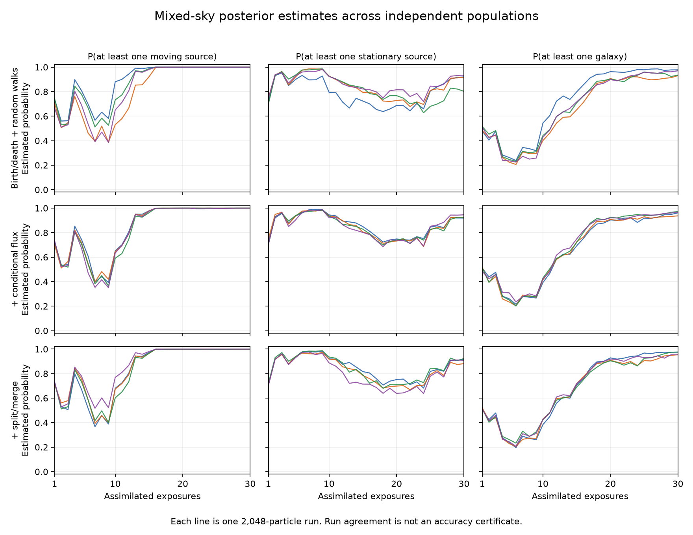

# Thirty-exposure mixed-sky follow-up

**The first exposure milestone remains unresolved.** The new engine processes
the joint mixed-sky model and supports incremental updates, but the separate
million-draw global audits at 10 and 30 exposures still return `[0,1]` for
every requested event. The original 0.01 evidence-gap and probability-width
targets are unchanged. The full FitSky objective is not achieved.

## Fixed problem and implementation

The source priors, shared calibration priors, truth and first three observations
are exactly those of the original failed broad scene. Add 27 independently
rendered synthetic observations, retaining a total of **30 small 3-by-3 images**.
These are not thirty survey images. The model includes stationary and moving
stars, parallax, variability, extended sources, unknown source count, a shared
astrometric offset and gain uncertainty. The Poisson source-count prior is
unbounded; the old enumeration `max_count=3` is not used as a cap.

The executable `magictools-fit-sky-stream` starts from that complete prior and
revises catalogues as exposures arrive. It evaluates Gaussian or Poisson
likelihoods in pixel blocks and marginalizes shared Gaussian linear nuisance
jointly. Checkpoints retain the catalogue population, weights, RNG, inputs
and exposure history. Appending data requires the existing observations and
generative priors to remain unchanged. Predictive queries use a joint
likelihood ratio to retain calibration dependence.

There are three separately retained campaigns, each with four populations
of 2,048 particles and 20 rejuvenation sweeps per temperature step:

- Birth/death, full-prior refreshes, class changes and reflected parameter moves.
- The same method with additional conditional Gaussian flux draws.
- The flux method with additional same-class split/merge proposals conserving
  total flux and centroid, with the reversible-jump Jacobian included.

The [original contract](../SEQUENTIAL_CAMPAIGN.md) and
[follow-up contracts](../SEQUENTIAL_FOLLOWUP.md) precede their corresponding
results. All runs and all requested prefixes are retained.

## Results

The table and plot compare point estimates across independent populations.
**A range across four runs is not a confidence interval.** Agreement cannot
establish that an important posterior mode was found.

<!-- RESULTS -->

| Method | Exposures | Largest query spread (percentage points) | Evidence estimate max/min |
| --- | ---: | ---: | ---: |
| Baseline | 3 | 4.00 | 1.137 |
| Baseline | 10 | 35.01 | 2.027 |
| Baseline | 30 | 13.18 | 20.651 |
| Conditional flux | 3 | 5.37 | 1.242 |
| Conditional flux | 10 | 6.54 | 1.535 |
| Conditional flux | 30 | 4.74 | 2.507 |
| Flux + split/merge | 3 | 7.37 | 1.187 |
| Flux + split/merge | 10 | 16.70 | 1.235 |
| Flux + split/merge | 30 | 7.37 | 4.615 |

<!-- END RESULTS -->

Conditional flux has the tightest replicate ranges at 30 exposures in this
campaign. Adding split/merge does not consistently tighten those ranges.
Neither comparison identifies the true posterior or rules out a mode missed
by every run.



The two complete-prior audits are independent of the particle estimates.
Each uses 1,000,000 draws, analytic averaging of one source flux, an unbounded
Poisson prior and 99% simultaneous confidence within that report under the
stated floating-point sampling/model assumptions. Both fail the accuracy
target. Their confidence statements do not apply jointly across every run.

## Computational and scientific limits

Every catalogue proposal still revisits the assimilated observations. Rendering
workspace is bounded by the pixel block, but the input images and metadata
remain in memory; one-at-a-time assimilation can take quadratic total work in
exposure count. These timings were measured on a shared host with overlapping
jobs, so they are not portable hardware benchmarks.

The renderer implements simple star/galaxy response models. It does not include
orbital propagation, arbitrary instrument responses, astronomical-scale data
storage or all-sky source priors. A thousand-exposure scalar likelihood test
checks block arithmetic and log-space underflow handling, not a thousand-image
mixed-sky inference result.

The separate [photon-partition pilot](../photon_partition_pilot/README.md)
analytically sums all source counts for Poisson photon models. Its controls
agree with independent calculations, including continuous flux and sources
that emitted no recorded photons. It fixes geometry and has exponential
cost in observed photon count; it does not resolve this Gaussian broad scene.

## Reproduction and retained artifacts

```sh
OPENBLAS_NUM_THREADS=1 python -m research.fit_sky.sequential_experiments NEW_BASELINE --seed 20261110
OPENBLAS_NUM_THREADS=1 python -m research.fit_sky.sequential_experiments NEW_FLUX --seed 20261120 --pilot --gibbs-flux
OPENBLAS_NUM_THREADS=1 python -m research.fit_sky.sequential_experiments NEW_SPLIT --seed 20261140 --pilot --gibbs-flux --split-merge
OPENBLAS_NUM_THREADS=1 python -m research.fit_sky.sequential_audit NEW_AUDIT_10 --exposures 10
OPENBLAS_NUM_THREADS=1 python -m research.fit_sky.sequential_audit NEW_AUDIT_30 --exposures 30
```

Use the corresponding executed source snapshot/commit when reproducing a
historical variant. Baseline source is `bcc7c19`, conditional-flux source is
`822b67d`, and split/merge source is `f40a201`. Later fixes retain the same
target but can change seeded floating-point trajectories.

Each `runs/SEED` contains inputs, settings, reports, a completed checkpoint,
executed sources, stdout and artifact inventories. Large prefix catalogues
are losslessly compressed as `prefix-N.json.gz`. `encoding.json` and the
original execution inventory verify their decompressed bytes. The final
checkpoint retains the numeric population.

`summarize.py` checks inventories, the original data/prior equality, and every
completed run before producing `summary.json` and the plot. `pilot-256` retains
the earlier small exploratory run. `installed-first` and `installed-resumed`
come from the actual installed command, run outside the repository.

The combined repository suite passes **467 tests**, with one optional local
JPL-kernel test skipped. Independent controls cover dense shared covariance,
analytic posterior/evidence calculations, count and class priors, split/merge
Jacobians, conservation laws, source/exposure permutations, zero Poisson
likelihoods, prediction and exact checkpoint replay. The installed wheel's
FitSky source files match the tested workspace. See
[validation provenance](../sequential_validation.json).
