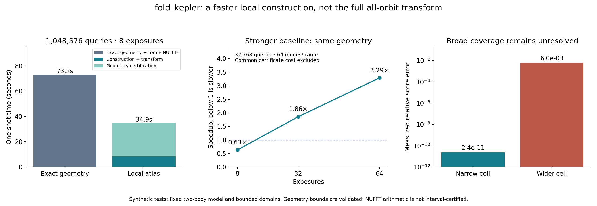

# Second construction campaign: measured results

**A useful local construction was achieved. The full all-orbit objective was
not achieved.** These are synthetic model experiments, not real-survey results
or a claim of mathematical novelty.



## Positive results

| Experiment | Measured result | Scope |
| --- | --- | --- |
| 6D atlas, 1,048,576 queries, eight exposures | 73.17 s for fresh exact geometry + per-frame NUFFTs; 34.92 s for the atlas **including 26.39 s of geometry certification**: **2.10×** | One bounded near-parabolic state cell; eight outer queries and 131,072 inner queries each. Geometry and analytic phase bounds cover the entire continuous 6D cell. |
| Same atlas, certification excluded | 8.53 s: **8.58×** | Timing decomposition, **not** the complete certified one-shot cost. |
| Same atlas, score accuracy | Relative error **2.41e-11**, maximum absolute difference **2.75e-9** | Uniform geometry contribution ≤4.91e-8; analytic phase tail ≤7.40e-9. Bounds exclude floating-point phase and NUFFT error. |
| Same-geometry baseline, 64 exposures, 131,072 queries | **3.73×** including common polynomial construction | Median of three order-alternating trials, against the same polynomial geometry evaluated with a NUFFT per exposure. Common geometry-certificate cost excluded from both. |
| Pixels, masks, varying known variances | **3.30×**, identical top candidate, maximum S/N difference **1.91e-10** | 32,768 queries; eight synthetic periodic 17×17 detectors; numerator and information both evaluated. Geometry certification excluded here. |
| Independent pixel-space calculation | Numerator difference ≤1.13e-11; information difference ≤4.60e-13 | Direct templates on selected paths, including the top candidate and injection. |
| Inverse | LSQR agrees with an independent dense regularized least-squares solution | Finite Fourier-coefficient inverse; no unique recovery of arbitrary original exposures. |

The atlas samples 729 trajectories rather than the 1,048,576 queried
trajectories: 5,832 ordinary orbit/frame evaluations, plus explicitly counted
interval and variational work. No full trajectory bank is first integrated and
then hidden in preprocessing.

## Failures and limits

- **Broad 6D cell:** increasing distance/radial-velocity widths by 500 gave
  relative score error **0.00605**, with a geometry contribution bound of
  **3.54** in absolute score units. Geometry coverage failed, while the phase
  tail stayed small. Including certification, this case was also much slower.
- **Broad inner patch:** a 30-fold width increase exceeded the NUFFT grid-volume
  work budget. The recorded quadratic-model error also remained nonzero. This
  is a failed request, not a silently narrowed successful one.
- **Short cadence:** against the same geometry at eight exposures, speedup was
  **0.63×**, a loss. At 32 and 64 exposures it was **1.86×** and **3.29×** for
  32,768 queries. These include construction but exclude common certification.
- **Sampled butterfly:** rank 16 produced physical score errors of roughly
  5.8–37% at 1,024 queries. Increasing rank repaired accuracy but required more
  entries/storage than a dense matrix and stayed slower than the fast baseline.
  The 4,096-query physical experiment also failed.
- **Constant-score interval atlas:** all 64 final cells were retained, but
  1e-8 absolute accuracy was not reached. Exact partition checks confirm no
  part of the initial box was discarded.
- Arbitrary WCS/instrument response, real-survey calibration, broad domain
  tiling and globally efficient outer-coordinate synthesis remain open.

The [derivation](../construction.md) explains the bounds, costs and inverse.
The [predeclared objectives](../construction_objective.md) remain the standard
for full completion. A new celestial discovery is not required.

## Artifacts and reproduction

`complete.json` records the completed campaign, source hashes and versions.
Individual case JSON files duplicate its case records for convenient inspection.
`stronger-baseline.json` records the separate same-geometry comparison.
`pixel-inputs.npz` retains synthetic images, variances, masks, injected state,
queries and flux. `verification.json` records certificate replay.
`inventory.json` hashes archived artifacts, excluding itself.

```
OPENBLAS_NUM_THREADS=1 python -m research.kepler_transform.construction_experiments /tmp/new-kepler-results
OPENBLAS_NUM_THREADS=1 python -m research.kepler_transform.comparison_experiments /tmp/new-kepler-comparison.json
OPENBLAS_NUM_THREADS=1 python -m research.kepler_transform.verify_construction research/kepler_transform/construction_results
```

Timings depend on hardware. Reproduction should verify errors, coverage and
counted work; it need not reproduce exact wall-clock ratios.
