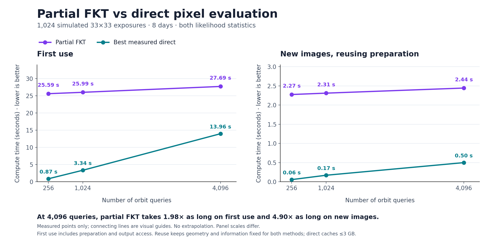

# Finite-detector likelihoods on the time-compression route

This phase connects original detector pixels to the time-compressed Fourier
representation. It adds a usable likelihood adapter and validates the complete
composition on a larger controlled stack. **It does not produce an end-to-end
speed advantage over the stronger direct pixel baselines tested here.**

The preceding [time-compression result](../temporal/README.md) remains a result
for common-grid Fourier inputs and Fourier evaluation baselines. Its measured
speedups must not be presented as pixel-to-detection speedups.

## What is implemented

* A common angular Fourier grid for finite images with different affine pixel
  maps, rotations, shear, scale, Gaussian PSF widths, masks, diagonal noise
  variances and flux calibrations. Original images are **not resampled**.
* Both Gaussian likelihood statistics: the matched-filter numerator and
  information, including a separately profiled constant background per frame.
* Uniform bounds for PSF Fourier truncation and artificial periodic copies;
  optional coefficient removal charged by its l1 norm.
* Numerator-specific grids that avoid generating unnecessary information
  modes when image values change.
* Separate time plans at the actual numerator/information bandwidths. Each
  retains the full original orbit box and obtains a fresh interval certificate.
* S/N and flux intervals that mark nonpositive-information cases unresolved.
* Strong direct pixel baselines: separable streaming, cached one-dimensional
  PSF factors, and a full pixel-response matrix when it fits the same budget.

The [derivation](theory.md) gives the finite-detector model, Fourier formulas,
error composition, source-domain coverage and complete work/storage accounting.
The library lives in [fields.py](fields.py), [plan.py](plan.py) and
[pixel_cache.py](pixel_cache.py). No six-dimensional orbit tensor is introduced.

## Real ZTF pixel replay

The experiment reuses the **three real ZTF exposures already retained in this
repository**, spanning 12.3 minutes. It does not duplicate them to claim a dense
survey stack or claim newly downloaded data. Their original FITS files, variance
and mask arrays, calibration, recorded Earth/site ephemerides and WCS headers
are bound by hashes.

At 256 orbit queries from the earlier real-data experiment:

| Comparison | Maximum S/N discrepancy |
| --- | ---: |
| Common-grid Fourier likelihood vs independent affine-WCS pixel integrals | 1.20e-10 |
| Common-grid likelihood vs pixel integrals using the full TPV WCS | 3.40e-7 |

Both comparisons preserve the best supplied query. The first tests the declared
affine model. The second measures its sampled WCS discrepancy; it is not a
continuous distortion certificate.

This replay validates the **detector adapter**, not a real-survey time
compression claim. The actual Earth/site ephemerides are not covered by the
existing circular-observer time certificate. Time compression is not applied
to this three-exposure stack. Gaussian PSFs and estimated diagonal variances
remain approximations to the real instrument.

The retained [real results](results/real-ztf/results.json) and
[score arrays](results/real-ztf/scores.npz) include the direct affine and TPV
comparisons. Fourier preparation and queries together take about 18 ms here;
direct pixels at the same positions take about 0.9 ms. This is not a speed win.

## Larger complete likelihood experiment

The controlled workload contains **1,024 independently simulated 33×33
exposures over eight days**, with irregular cadence, varying PSFs and affine
maps, nonuniform variances, masks, flux scales and backgrounds. A source of
flux 10 follows the center Kepler orbit. Pointings track that reference orbit,
within the unchanged original near-domain/circular-observer model.

The real-time interval proof bounds the source positions across the whole
six-dimensional box before choosing queries. The initial detector field has
269×269 modes. A separate bounded numerator construction retains 103×103 modes;
information trimming retains 133×133. The actual bandwidth requires **299
time nodes for the numerator and 378 for information**, rather than the
82-node order from the earlier lower-bandwidth example.

All measured candidate sets retain the injected orbit as the highest-scoring
resolved query. Its recovered flux is **10.245** and S/N **63.97**. At up to
4,096 orbit queries:

* Maximum numerator difference from independent direct pixels: `7.70e-10`.
* Maximum information difference: `2.08e-9`.
* Maximum S/N difference: `9.91e-10`.
* Analytic absolute approximation budgets: `9.81e-6` in numerator and
  `5.75e-8` in information, covering the whole declared orbit box in exact
  arithmetic.

These analytical budgets add detector approximation, discarded coefficients
and time interpolation. They do not certify floating-point coefficient
construction or numerical orbit propagation.

### Complete measured times

Times are seconds. First use includes all detector preparation, trimming,
proof construction, both transforms, query geometry and both output statistics.
For changed image data, both methods reuse geometry and information, which is
independent of image values when variance/masks/PSFs remain fixed.

| Orbit queries | First use: direct pixels | First use: compressed | New images: cached pixels | New images: compressed |
| --- | ---: | ---: | ---: | ---: |
| 256 | 0.873 | 25.591 | 0.056 | 2.274 |
| 1,024 | 3.343 | 25.992 | 0.170 | 2.310 |
| 4,096 | 13.961 | 27.694 | 0.499 | 2.443 |



Download the graph as [SVG](results/timing_comparison.svg) or
[PDF](results/timing_comparison.pdf). The [plotted data](results/timing_comparison.json)
records the source report hash. Regenerate it with
`python -m research.kepler_transform.detector_time.plot`.
Lines connect measured points only; no crossover or asymptotic scaling is inferred.

The direct factor caches fit the declared **3 GB** cache budget, including the
4,096-query case. The full pixel-response cache is also measured when it fits.
The report chooses the fastest measured direct option. It does not compare the
new method only against an unnecessarily expensive Fourier sum or an uncached
pixel implementation.

The one-time work explains most of the first-use loss:

| Stage | Seconds |
| --- | ---: |
| Detector plan and bounds | 1.42 |
| Initial Fourier likelihood fields | 12.40 |
| Frequency selection and trimming | 8.96 |
| Two time plans | 0.07 |
| Two time compressions | 1.83 |

At fixed geometry, numerator preparation and compression still take about
2.12 s before output access, versus 0.50 s for the strongest measured direct
cache at 4,096 queries. An additional [compression-backend probe](results/compression-probe.json)
compares dense and fast cosine-moment implementations on the same detector
workload; its timings are retained separately rather than replacing the full
pipeline measurements above.

That probe also loses: at 4,096 queries the complete changed-image numerator
path takes 2.52 s with dense time moments and 3.26 s with NUFFT time moments.
The two outputs agree within `3.19e-12`. Accelerating the time moments alone
does not remove the detector preparation bottleneck.

The [small control](results/small-control/results.json), with 128 nine-by-nine
images, loses by much more. Its 34 unresolved information intervals are retained
explicitly; the code does not convert near-zero information into a detection.
The dense 33×33 workload has no unresolved information cases among the tested
queries.

## Assessment and remaining work

This phase closes a useful part of the input-model gap: finite masked pixels
now feed both likelihood statistics on a common angular grid with an explicit
error budget. It also shows that the earlier Fourier-input speedup does **not**
yet survive a stronger end-to-end comparison.

The next mathematical target is to fuse detector-to-field preparation with
time compression, or otherwise avoid constructing and scanning the full
per-exposure Fourier arrays. The current representation still warrants
investigation, but this implementation should not replace the tested direct
pixel methods for these workloads.

A validated real-ephemeris/pointing model, continuous WCS-distortion bounds,
empirical/trailing PSFs, correlated noise, stable inversion, and affordable
whole-archive search remain open. No new discovery, general FKT or mathematical
breakthrough is claimed.

## Reproduce and use

Validation: **414 tests passed, one skipped** across the repository, including
eight new detector/time tests. The retained replay checks 1,152 per-exposure
template bounds, both source-domain proofs, four time-interpolation proofs,
eight full synthetic score vectors and 256 real-pixel score pairs. It also
recomputes 153 synthetic queries independently. A built and separately installed
wheel passes a pixel-to-compressed-score smoke test.
The [verification record](results/verification.json) records these checks and
artifact hashes.

From the repository root with the research and acceleration dependencies:

```bash
export OPENBLAS_NUM_THREADS=1 OMP_NUM_THREADS=1 MKL_NUM_THREADS=1 NUMBA_NUM_THREADS=1
python -m pytest -q tests/test_kepler_detector_time.py
python -m research.kepler_transform.detector_time.real_experiment NEW_DIRECTORY/real-ztf
python -m research.kepler_transform.detector_time.benchmark NEW_DIRECTORY/small-control --frames 128 --side 9 --counts 128 --cache-bytes 3000000000
python -m research.kepler_transform.detector_time.benchmark NEW_DIRECTORY/dense-1024 --frames 1024 --side 33 --counts 256 1024 4096 --cache-bytes 3000000000
python -m research.kepler_transform.detector_time.compression_probe NEW_DIRECTORY/dense-1024 NEW_DIRECTORY/compression-probe.json
python -m research.kepler_transform.detector_time.verify NEW_DIRECTORY/*/ --recompute
```

Benchmark output directories must not already exist. Inputs, complete retained
score vectors, bounds, proof records, source hashes and repeated timing samples
are saved. Timings are local measurements on a shared host; imports and common
orbit-solver JIT startup are excluded for both methods. Input generation and
independent validation are outside timed computation.

For image preparation in another caller:

```python
from research.kepler_transform.detector_time import CommonDetector

detector = CommonDetector(
    variances, sigma_pixels, pixel_to_common_arcsec,
    offsets=stamp_centers_arcsec, masks=masks, flux_scales=flux_scales,
    source_half_width=allowed_source_half_width_arcsec,
)
numerator, information, model_bounds = detector.prepare(images)

# New image data, same detector model: select and validate a numerator-only grid.
cutoff, budget = detector.choose_numerator_cutoff(images, absolute_budget=1e-5)
new_numerator, new_budget = detector.prepare_numerator(new_images, cutoff)
```

`CommonDetector` coordinates are arcseconds, image axes are `(exposure,y,x)`,
and Fourier coefficient axes are `(exposure,kx,ky)`. `DetectorTimePlan` converts
its frequency spacing to radians internally and supports only the explicitly
certified benchmark observer/domains; it is not a generic real-survey orbit API.
