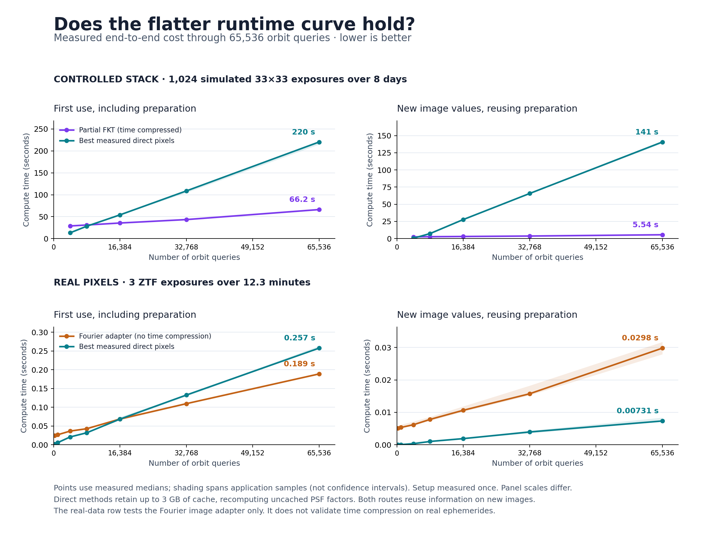
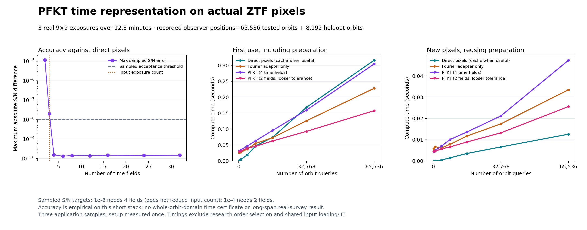

# Larger orbit-count and real-pixel follow-up

This experiment extends the measured range from 4,096 to **65,536 orbit
queries**. It separates three questions:

1. Does certified time compression amortize its preparation on the same
   eight-day, 1,024-exposure simulated stack?
2. Does the common-grid Fourier image adapter help on real ZTF pixels when
   many more trajectories are requested?
3. Does the PFKT **time representation itself** reproduce direct likelihoods
   on those real pixels with recorded observer positions?

The second experiment does **not** apply the circular-observer time
certificate to real ephemerides. It evaluates the Fourier fields at each of
the three actual exposure times, using the recorded Earth/site positions.
The third experiment applies the time construction empirically, without
borrowing that certificate. It measures both a two-field compressed version
and a four-field high-accuracy version. All real-data runs still use only
three exposures over 12.3 minutes.

## Measured results



On the eight-day **simulated** stack:

| Orbit queries | First direct (s) | First PFKT (s) | New pixels, direct (s) | New pixels, PFKT (s) |
| ---: | ---: | ---: | ---: | ---: |
| 4,096 | 13.15 | 28.77 | 0.478 | 2.523 |
| 8,192 | 28.17 | 30.95 | 7.294 | 2.701 |
| 16,384 | 54.02 | 35.50 | 27.688 | 3.017 |
| 32,768 | 108.69 | 43.33 | 65.686 | 3.692 |
| 65,536 | 220.32 | 66.16 | 140.692 | 5.542 |

All direct rows above use the explicit **3 GB retained-cache budget**.
First-use crossover occurs between 8,192 and 16,384 queries. At 65,536,
PFKT is 3.33 times faster on first use. Its curve is not flat: a sixteenfold
increase in queries increases first-use time 2.30 times, versus 16.75 times
for direct evaluation. All 65,536 sampled S/N differences are below 9.91e-10.
The retained numerator/information time orders remain 299/378; their combined
fields occupy approximately 158 MB, excluding query and native workspaces.

The reuse win is **memory-dependent**. Separate complete-factor-cache controls
reverse the result at two query counts:

| Queries | Direct cache budget | Full direct factors | Cached direct reuse (s) | PFKT reuse above (s) |
| ---: | ---: | ---: | ---: | ---: |
| 8,192 | 6 GB | 4.43 GB | 0.910 | 2.701 |
| 16,384 | 12 GB | 8.86 GB | 1.948 | 3.017 |

The [6 GB](results/scaling/cache-6gb.json) and
[12 GB](results/scaling/cache-12gb.json) controls reuse the identical query
coordinates and images and independently check changed-image applications.
They measure cache construction too; the table isolates reuse. They were
run separately, so comparison with the original campaign includes host variability.

The first real-data sweep in the lower graph panels tested the **adapter
only**. At 65,536 queries it took 0.189 s versus 0.257 s direct on first use,
but 0.0298 s versus 0.00731 s for cached reuse. Those results did not establish
that PFKT time compression worked on actual pixels.

## PFKT on real pixels: correcting the adapter-only gap

For a simple two-curve view, see [PFKT versus direct first-use timing](results/scaling/pfkt-vs-direct.png).
It plots the same measured real-pixel results below, using the two-field PFKT
setting and its stated accuracy tradeoff.



The [additional executable](real_time.py) runs the same time-field construction
on the original ZTF pixels, recorded reception times and observer positions.
Its auxiliary observer trajectory is a quadratic interpolant through the
three stored positions. At every actual exposure, both observer coordinates
and projected coordinates match the original evaluation exactly in this run.
The interpolant is an extension used to construct auxiliary time nodes;
no physical accuracy between exposures is asserted.

The transform first modulates each Fourier field by the center-orbit phase,
then combines the exposure fields with Chebyshev cardinal weights. Orbit
queries evaluate the resulting fields at their residual positions relative
to that center orbit at the auxiliary time nodes. Both likelihood statistics
are transformed. This is the PFKT time representation applied to real pixels,
not the uncompressed Fourier adapter.

| Time fields | Maximum sampled absolute S/N error | Relative to 3 input exposures |
| ---: | ---: | --- |
| 2 | 1.1453e-5 | Compresses to two fields |
| 3 | 2.0018e-8 | Same field count |
| 4 | 1.5620e-10 | Expands to four fields |

Orders 6, 8, 12, 16, 24 and 32 were also tested and saved. The strict sampled
1e-8 S/N target first passes at order four. An explicitly separate 1e-4 target
passes at order two; this looser tolerance is not presented as a strict pass.
Order selection uses 65,536 queries, including the center and all 64 corners.
An independently seeded 8,192-query holdout has maximum S/N errors 9.50e-6
and 1.51e-10 for two/four fields, respectively. Changed-image checks cover
all 65,536 original queries and give 8.01e-6 and 1.09e-10.

All four routes were timed again together for this additional campaign.
At 65,536 queries:

| Method | First use including preparation (s) | Changed pixels with cached preparation (s) |
| --- | ---: | ---: |
| Direct pixels | 0.3161 | 0.01260 |
| Fourier adapter only | 0.2280 | 0.03348 |
| PFKT, four fields, sampled 1e-8 target | 0.3043 | 0.04736 |
| PFKT, two fields, sampled 1e-4 target | 0.1579 | 0.02559 |

Two-field PFKT is about **2.00 times faster on first use** in this short-stack
run, with its stated accuracy tradeoff. Cached direct pixels remain about
**2.03 times faster for reuse**. The four-field first-use difference is small
enough to treat cautiously; timings are local measurements, not a robust
cross-machine performance claim. Research order selection is excluded from
these operating costs and is explicitly recorded as such.

The real-data time errors are **empirical**, not whole-domain guarantees.
The original detector model bounds remain scoped to affine WCS and the chosen
Gaussian PSFs. A separate 96-query full-TPV WCS check in the adapter campaign
has maximum S/N discrepancy 3.62e-7; the very small four-field interpolation
error does not eliminate that astrometric-model approximation.
This is a real-pixel correctness and limited compression result, not evidence
that three frames stand in for a long survey or the public archive.

## Verification and retained evidence

The [dense](results/scaling/dense/results.json),
[real adapter](results/scaling/real/results.json), and
[real time](results/scaling/real-time/results.json) records include raw timing
samples, source/input hashes, parameter vectors and complete score vectors.
Fresh replay checks all saved vectors, independently recomputes pixel
templates at 96 corner/interior queries per campaign, and reconstructs the
two simulated-stack time proofs. The numerical comparisons include explicit
roundoff allowances; exact-arithmetic bounds are not floating-point certificates.
The [verification record](results/scaling/verification.json) records 12 passing
focused tests, replay outcomes and final artifact hashes. The full repository
test suite was not rerun in this phase.

## What is held fixed

The simulated images, masks, variances, Gaussian PSFs, affine maps, flux
calibration, eight-day span and original six-dimensional near-orbit box are
identical to the preceding experiment. The first 4,096 query coordinates are
unchanged. Additional coordinates sample that same box with a saved seed;
the center and all 64 corners remain included. No image is duplicated to
increase the exposure count, and no query is removed for being difficult.

The real experiment uses the retained three nine-by-nine ZTF cutouts. It
samples the bounding rectangle of the preceding real-data query set, including
its center and all corners, and saves every parameter. It uses the actual
stored ephemerides and reception times. The timing model uses local affine
WCS and Gaussian PSFs; a separate comparison samples the full TPV WCS and the
independent Python orbit propagator.

A fresh IRSA metadata query for the same sky patch, red filter, quality filter
and an eight-day window returned these same three public exposures.
The retained [query](results/scaling/real-availability/query.json) and
[response](results/scaling/real-availability/index.json) describe that limited
selection. This is not a statement about exposure availability elsewhere in
ZTF, other filters or other dates.

## Direct caches and fair accounting

The original full factor cache exceeds 3 GB as the query count increases.
The new baseline instead retains as many complete per-query PSF factors as
fit and recomputes the rest in batches. It also retains positions and the
information statistic for **all** queries. New image applications therefore
compute only the numerator, including for the uncached portion. Position,
information and factor arrays all count toward the cache budget.

The full pixel-response matrix is also tested whenever it fits. First-use
comparisons choose the fastest measured direct option, including the
streaming implementation, whose performance does not depend on retaining
all PSF factors. Direct query geometry is charged. Compressed first use
includes detector preparation, mode selection, proof construction, both
compressions, query-plan construction and both output statistics.

For new image values, both routes reuse fixed geometry and information.
The compressed route still rebuilds and checks the numerator field, compresses
it and accesses every requested result. A changed-image check independently
verifies that neither method substitutes the old answer vector.

Three timed applications are retained per measurement. First-use setup is
measured once. Shared import/JIT startup, loading the retained inputs and
independent validation are outside the timers for both routes. Query generation
is also excluded for both. Numerical thread limits are set to one for both routes. Timings are local
measurements on a shared host, not hardware-independent complexity estimates.

The 3 GB cache limit is **not** a limit on total process memory: temporary
arrays, common detector data and native NUFFT workspaces exist in addition.
At 65,536 queries the complete double-precision direct PSF-factor cache alone
would require about 35.4 GB. Results in this memory regime must not be described
as wins over an unlimited-memory direct cache.

## Interpreting the curve

A large constant preparation cost plus a smaller per-query cost can look flat
at low query counts. Neither implementation is constant-time in the number
of returned scores. For fixed time orders and Fourier grids, compressed query
geometry and NUFFT evaluation still have a term proportional to query count.
Returning every score itself requires at least linear work.

The useful question is where the measured total cost crosses the direct
method, and whether that crossover survives changes to memory, cadence,
observation span, detector model and query distribution. A crossover in this
experiment is a useful operating regime, not an archive-wide transform,
an inverse, a discovery, or an asymptotic breakthrough.

## Reproduce

```bash
export OPENBLAS_NUM_THREADS=1 OMP_NUM_THREADS=1 MKL_NUM_THREADS=1 NUMBA_NUM_THREADS=1
python -m pytest -q tests/test_kepler_detector_scaling.py tests/test_kepler_detector_time.py
python -m pytest -q tests/test_kepler_real_time.py
python -m research.kepler_transform.detector_time.scaling NEW/real --kind real --counts 256 1024 4096 8192 16384 32768 65536
python -m research.kepler_transform.detector_time.scaling NEW/dense --counts 4096 8192 16384 32768 65536
python -m research.kepler_transform.detector_time.cache_probe NEW/dense NEW/cache-6gb.json
python -m research.kepler_transform.detector_time.cache_probe NEW/dense NEW/cache-12gb.json --queries 16384 --cache-bytes 12000000000
python -m research.kepler_transform.detector_time.verify_scaling NEW/dense NEW/real
python -m research.kepler_transform.detector_time.scaling_plot NEW/dense/results.json NEW/real/results.json NEW/comparison
python -m research.kepler_transform.detector_time.real_time NEW/real-time
python -m research.kepler_transform.detector_time.verify_real_time NEW/real-time
python -m research.kepler_transform.detector_time.real_time_plot NEW/real-time/results.json NEW/real-time-comparison
python -m research.kepler_transform.detector_time.simple_comparison_plot NEW/real-time/results.json NEW/pfkt-vs-direct
```

Run timing campaigns sequentially to avoid competing for resources. Output
directories must not already exist. The scripts require the same optional
research dependencies as the preceding phase. The largest direct evaluations
can take several minutes each.
