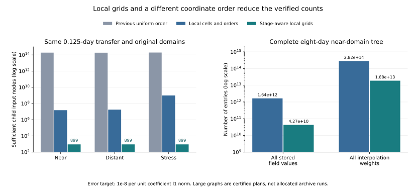

# Locally sufficient Kepler grids: certificates and total costs

The strongest construction changes hidden coordinates first and bounds each
actual interpolation stage in child coordinates. This preserves the exact
constant directions of instantaneous exposure fields. Both this variant and
the preceding, larger construction are retained below.

All bounds concern Fourier angular fields on the original bounded six-state
Kepler domains, with `|kx|,|ky| <= 1/ARCSEC`: one radian of phase per arcsecond,
not one cycle per arcsecond. Errors are per unit input Fourier-coefficient l1
norm. No new archive images were used in this mathematical campaign.



## Short-transfer child input grids

Every case retains its original state box, transfers from day 0 to 0.125 and
requests error at most `1e-8`. The earlier uniform estimates are from
[`constructive_results/local.json`](../constructive_results/local.json).

| Domain | Previous uniform-order grid | First local-grid construction | Stage-aware child grid |
| --- | ---: | ---: | ---: |
| Near | 191,102,976,000,000 | 14,957,250 | 899 |
| Distant | 186,374,892,382,561 | 17,625,600 | 899 |
| Stress | 195,930,594,145,441 | 980,470,400 | 899 |

**These are child input grids, not entire parent orbit fields.** The 899-node
fields have orders `(1,1,1,31,29,1)` in the repository's coordinate convention.
Only the two angular directions vary at an instantaneous exposure. The new
stage ordering preserves that identity instead of expanding the child input
into a six-dimensional tensor. Parent grids and mixed intermediate grids are
still charged separately in the complete-tree counts below.

The stage-aware short-transfer bounds are `6.578e-9`, `6.465e-9`, and `9.193e-9`.
The first local construction's bounds are `9.975e-9`, `9.679e-9`, and `9.856e-9`.
These are sufficient counts, not measured speedups or proofs of minimal size.

## Complete original eight-day near-domain tree

The eight original exposures span days -4 through +4. Both constructions cover
the entire original state box with one patch and include all transfers plus
continuous interpolation of the root field.

| Quantity | First local construction | Stage-aware construction |
| --- | ---: | ---: |
| Root field nodes | 937,185,025 | 906,953,250 |
| All stored field values | 1,637,224,734,961 | 42,694,546,242 |
| All mixed intermediate nodes, summed | 6,459,587,021,908 | 560,041,367,700 |
| Interpolation weights / application multiply-add pairs | 281,602,887,669,794 | 18,789,305,900,400 |
| Largest individual field or intermediate grid | 160,635,908,160 | 18,770,875,200 |
| Weight values alone at 8 bytes each | 2,252,823,101,358,352 bytes | 150,314,447,203,200 bytes |
| Continuous-field error bound per unit l1 | 9.2892e-9 | 9.2307e-9 |

The new ordering reduces all stored field values by **38.3 times** and weights
by **15.0 times**. No frames, conic classes or original states were removed.
Each version's 15 grid certificates, whole-tree error and intermediate counts
were independently replayed.

**The sufficient full-tree plan remains too large for a practical archive run.**
These large arrays were not allocated. Node values, sparse indices, source leaf
kernels, source preparation and queries add to the weight-byte figure.
Materialization checks allocation budgets before constructing matrices.

## Complete original 30-day distant-domain tree

The 32 original exposures span days -15 through +15. Both constructions cover
the entire original state box with one patch.

| Quantity | First local construction | Stage-aware construction |
| --- | ---: | ---: |
| Root field nodes | 5,223,571,200 | 18,013,968,000 |
| All stored field values | 4,096,385,487,711,672 | 15,032,951,005,080 |
| All mixed intermediate nodes, summed | 25,960,383,022,906,464 | 159,146,091,800,080 |
| Interpolation weights / application multiply-add pairs | 1,234,081,525,347,055,968 | 6,114,260,061,152,480 |
| Largest individual field or intermediate grid | 317,798,974,977,120 | 1,171,609,920,000 |
| Weight values alone at 8 bytes each | 9,872,652,202,776,447,744 bytes | 48,914,080,489,219,840 bytes |
| Continuous-field error bound per unit l1 | 9.4145e-9 | 9.4774e-9 |

The new ordering reduces all stored field values by **272.5 times** and weights
by **201.8 times**. The root alone is larger: separate local optimization and
error allocations need not improve every individual grid. The complete tree,
including every mixed intermediate grid, determines the comparison.
Both versions' 63 grid certificates and total counts were independently replayed.
These remain sufficient plans whose arrays were not allocated.

## Complete baseline stress-domain audit

The first local construction also obtained a complete sufficient plan for the
original stress domain. This establishes finite full-domain counts; it is not
a favorable performance result. The stage-aware full stress tree has not been
constructed.

| Domain and original cadence | Patches | All stored field values | Interpolation weights | Continuous error / l1 |
| --- | ---: | ---: | ---: | ---: |
| Stress, 8 exposures over 8 days | 16 | 8,442,617,776,798,201 | 1,789,282,782,113,087,028 | 9.3279e-9 |

The stress campaign starts from an outward-rounded 4 by 4 partition of inverse
range and radial rate. An exact rational cover check verifies the original
box before planning and again afterwards. Each tile retains the full original
cadence, bandwidth and error target. The validated integration maximum step is
0.125 days in this tiled campaign; it is 0.03125 days in the near/distant runs.
No additional adaptive splits were needed inside these 16 tiles. Earlier broad
stress-box trials were replaced by this explicit tiling, not counted as a
successful partial cover.

Independent replay checked 240 grids in the stress cover, including the exact
cover and all accumulated weight counts.
The large baseline artifacts are stored as lossless gzip files, together with
compressed/uncompressed SHA-256 records and verification reports.

## Actual executable numerical regressions

Both numerical runs use the same original near-domain state box, frequency
bound and two exposures. Their very short time span is `2e-7` days (0.01728
seconds), so these are numerical regressions, not survey or archive benchmarks.

| Quantity | First local construction | Stage-aware construction |
| --- | ---: | ---: |
| Allocated field values | 76,464 | 15,708 |
| Allocated transfer weights | 4,518,396 | 1,842,324 |
| Leaf-kernel entries | 63,000 | 2,244 |
| Certified analytic interpolation error / l1 | 7.315e-9 | 6.539e-9 |
| Sampled error / l1 against independent Cartesian propagation | 3.23e-14 | 3.66e-14 |
| Absolute adjoint inner-product discrepancy | 1.37e-13 | 1.88e-13 |

Each run checks 64 independent queries. Those samples are regression checks,
not the basis of the uniform analytic certificate. Planned and allocated
transfer-entry counts match exactly.

The full suite passed **399 tests, with 1 skip**. New tests cover off-grid
interpolation, ellipse inclusion, complete error propagation, mixed-coordinate
derivative witnesses, arbitrary intermediate tensor shapes, budget refusal,
restart-cache isolation, stage ordering, exact constant directions and tampered
certificate metadata. Floating-point orbit evaluation/application is not yet
certified by these analytic bounds.

## Reproduce and replay

Run from the repository root with the research dependencies available. Use a
separate new output directory for each invocation.

```bash
# Strongest stage-aware variant: local transfers, full trees, actual small graph.
OPENBLAS_NUM_THREADS=1 python -m research.kepler_transform.ordered.experiments NEW_DIRECTORY --mode local --case near
OPENBLAS_NUM_THREADS=1 python -m research.kepler_transform.ordered.experiments NEW_DIRECTORY --mode hierarchy --case near
OPENBLAS_NUM_THREADS=1 python -m research.kepler_transform.ordered.experiments NEW_DIRECTORY --mode numerical
OPENBLAS_NUM_THREADS=1 python -m research.kepler_transform.ordered.verify NEW_DIRECTORY/results.json

# Baseline and its complete stress-domain cover.
OPENBLAS_NUM_THREADS=1 python -m research.kepler_transform.local_resolution_experiments NEW_DIRECTORY --mode hierarchy --case distant --cache-directory CACHE_DIRECTORY
OPENBLAS_NUM_THREADS=1 python research/kepler_transform/local_resolution_results/run_tiled_stress.py NEW_DIRECTORY --cache-directory CACHE_DIRECTORY --workers 3
OPENBLAS_NUM_THREADS=1 python research/kepler_transform/local_resolution_results/verify_tiled_stress.py NEW_DIRECTORY --watch
OPENBLAS_NUM_THREADS=1 python -m research.kepler_transform.verify_local_resolution NEW_DIRECTORY/results.json
OPENBLAS_NUM_THREADS=1 python -m pytest -q
```

For a committed `.json.gz` artifact, decompress it into a fresh directory before
calling the relevant verifier. For example:

```bash
mkdir NEW_REPLAY_DIRECTORY
gzip -dc research/kepler_transform/local_resolution_results/hierarchy-stress/results.json.gz > NEW_REPLAY_DIRECTORY/results.json
OPENBLAS_NUM_THREADS=1 python -m research.kepler_transform.verify_local_resolution NEW_REPLAY_DIRECTORY/results.json
```

The complete stress artifact contains every retained tree. Redundant temporary
patch checkpoints and verification wrappers are not needed for this full-file
replay; the saved tile replay manifest records the completed checks. The tiled
runner recreates those checkpoints when reproducing the construction itself.

Every result hashes its source files. Baseline restart caches are keyed by
source, observer, precision and inputs and do not replace certificate replay.
Reports charge original cached planning work as well as the current run. Jobs
shared CPU resources and some independent branch plans were precomputed in
parallel; saved timings are work records, not dedicated speed benchmarks.

Read the [local-grid derivation](../local_resolution.md) and the
[stage-aware argument](../ordered/README.md) for the sufficient size law and its
uniform regularity assumptions. The instantaneous angular-field model does not
cover a rate-dependent trailing PSF without an additional leaf analysis.
Arbitrary detector preparation, practical archive complexity, floating-point
certification and the full inverse remain open.
