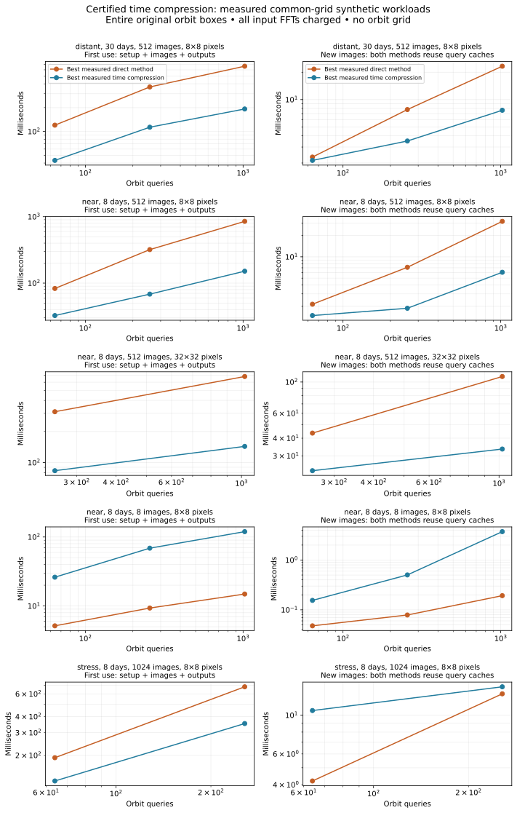

# A focused research phase: compress time, eliminate the orbit tensor

**Follow-up:** the [finite-detector likelihood campaign](../detector_time/README.md)
validates a real-pixel adapter and an eight-day, 1,024-exposure controlled stack.
Its complete likelihood pipeline is slower than optimized direct pixels and
their caches. The speedups below remain specific to their declared Fourier
inputs and Fourier evaluation baselines.

The objective of this phase is to make both transform application and result
access cheaper, with a justified total cost and accuracy across the full orbit
box. The candidate is a **different representation**, not a smaller
six-dimensional interpolation tensor.

For a dense stack on a common tangent-plane Fourier grid, the library replaces
`N` exposure fields by `p` Fourier fields at certified Chebyshev time nodes.
The orbit response is their sum evaluated along the true apparent Kepler path.
Construction does not need a list of query orbits. The derivative proof covers
the original full six-coordinate boxes; no difficult orbits are screened out.

The [derivation and complete cost accounting](theory.md) cover reference
modulation, input FFTs, dense or fast time moments, arbitrary query geometry,
output NUFFTs, construction, caching and storage. The sufficient orders at the
original bandwidth and `1e-8` interpolation tolerance are:

| Domain | Span | Time samples | Representation size |
| --- | ---: | ---: | ---: |
| Near | 8 days | 82 | 82 Fourier images |
| Distant | 30 days | 127 | 127 Fourier images |
| Broad near stress | 8 days | 490 | 490 Fourier images |

These are exact-arithmetic interpolation guarantees normalized by input
coefficient l1 norm. Numerical FFTs, NUFFTs and orbit propagation are checked
against direct and independent calculations but are not interval certified.
The transform is linear; an algebraic adjoint is available for dense and stream
query evaluators. It is not a stable inverse.

## Measured outcome and acceptance decision

**The bounded dense-cadence forward milestone is met. The general catalogue
objective is not.** There is a costed representation with no orbit tensor,
whole-domain analytic interpolation control, and executable wins against
cached direct methods over eight and 30 days. This justifies continuing this
representation for dense stacks. It does not justify further investment in
the previous enormous six-dimensional tensors on the strength of smaller
constant factors alone.

All times below are milliseconds. “Reuse” means **new image data with the same
queries**, including input FFTs and compression where applicable. Each entry
uses that method's best measured backend, not necessarily the same backend
on first use and reuse.

| Workload | Queries | First direct | First compressed | Reuse direct | Reuse compressed |
| --- | ---: | ---: | ---: | ---: | ---: |
| Near, 8 days, 8 images, 8×8 | 1,024 | 14.91 | 119.62 | 0.193 | 3.723 |
| Near, 8 days, 512 images, 8×8 | 1,024 | 851.21 | 151.43 | 31.66 | 6.05 |
| Distant, 30 days, 512 images, 8×8 | 1,024 | 666.98 | 192.48 | 23.31 | 7.62 |
| Near, 8 days, 512 images, 32×32 | 1,024 | 681.53 | 143.44 | 109.44 | 33.50 |
| Stress, 8 days, 1,024 images, 8×8 | 256 | 681.49 | 353.13 | 13.25 | 14.54 |

For the dense near case, this is **5.62× on first use and 5.23× on reuse**.
The distant case gives **3.47× and 3.06×**. For 32×32 images, the strongest
measured direct reuse method is a cached NUFFT plan, not a dense response
matrix; compression still gives **4.75× on first use and 3.27× on reuse**.
The 8×8 dense cases fit the full direct response matrix within the cache
budget, so the wins there include that baseline too.

The negative results are meaningful. Eight sparse exposures make compression
much slower. In the broad stress domain, 490 sufficient time samples leave
too little compression: first use improves, but cached direct evaluation is
faster on repeated inputs at both measured query counts. At just 64 queries
in the distant case the reuse difference is only about 9%, which is not a
robust speed claim on this shared host.

The dense time-matrix backend gives the best measured reuse totals in this
campaign. Fast NUFFT/Chebyshev compression is implemented and numerically
checked, and supplies the stronger conditional cost bound, but is not being
credited for the measured gains when the dense backend was faster.

For 32×32 images the compressed field has `82*1024 = 83,968` complex values,
about **1.34 MB**. Input buffers, modulation and optional query caches are
additional and included in the cost formulas. Dense query caches store
`pQK` complex entries; NUFFT query plans avoid that matrix. Library workspace
allocations are not included in the reported NumPy-array byte counts.



Thirteen workload/query-count configurations were checked. Every retained output
vector was compared with the direct sum; the largest normalized discrepancy
was **9.09e-14**, versus the analytic target of `1e-8`. Independent Python
orbit/light-time calculations check sparse-mode scores separately. Replaying
the five interval certificates and reconstructing 952 selected query outputs
passed. Those numerical checks support the executable implementation; they
do not replace the whole-domain analytic proof or certify roundoff.
The full repository suite passed **406 tests with one skip**. A built wheel
was installed into an isolated target directory and exercised outside the
checkout, including FFT input preparation, compression, arbitrary output access
and a direct score comparison.

Raw inputs, full output vectors, all timing samples, environment records,
proofs and source hashes are in [results](results). Values above are measured
workloads, not extrapolations to the public archive. The next justified
investment is a validated real-image/common-grid adapter and a larger dense
stack, with the existing strong direct baselines retained.

## Scope of the experiment

Inputs are synthetic periodic image arrays on a common Fourier grid, retaining
all their modes. The pixel-to-Fourier FFT is included in every input-to-output
comparison. The cutoff is one inverse arcsecond in both axes. The cadence is
irregular and includes both endpoints. Queries cover all 64 box corners and
random interior points. The sparse control uses the same eight-day span and
orbit box as the dense near case.

This is not a test on newly downloaded survey images. Arbitrary WCS/PSF/mask
preparation, finite exposure trails, an astronomical likelihood adapter,
complete floating-point certification, all-orbit maximum finding, stable
inversion and archive-scale behavior remain outside this result.

## Reproduce

The research dependencies include NumPy, SciPy, Numba, python-flint and FINUFFT;
Matplotlib is needed only for the plot. From the repository root:

```bash
export OPENBLAS_NUM_THREADS=1 OMP_NUM_THREADS=1 MKL_NUM_THREADS=1 NUMBA_NUM_THREADS=1
python -m pytest -q tests/test_kepler_temporal.py
python -m research.kepler_transform.temporal.benchmark NEW_DIRECTORY/near-sparse --frames 8 --side 8
python -m research.kepler_transform.temporal.benchmark NEW_DIRECTORY/near-dense --frames 512 --side 8
python -m research.kepler_transform.temporal.benchmark NEW_DIRECTORY/distant-dense --case distant --frames 512 --side 8
python -m research.kepler_transform.temporal.benchmark NEW_DIRECTORY/near-images --frames 512 --side 32 --counts 256 1024
python -m research.kepler_transform.temporal.benchmark NEW_DIRECTORY/stress-dense --case stress --frames 1024 --side 8 --counts 64 256
python -m research.kepler_transform.temporal.verify NEW_DIRECTORY/* --recompute
python -m research.kepler_transform.temporal.plot NEW_DIRECTORY
```

The benchmark refuses existing output directories. Five independent timing
batches are retained, along with inputs, full output vectors, certificate
records, source hashes and package versions. Compiler/import startup is excluded
for both methods and compiler startup is recorded. Selected-plan construction,
including its interval proof, is included in first-use totals. Setup is measured
once per option; applications use the median of repeated batches. The host is
shared, so these are measured local workloads, not hardware-independent forecasts.

Both methods use the same Fourier evaluator, numerical precision, thread limits
and dense-cache budget. Direct options include cached sky positions, cached
NUFFT plans and the full response matrix when it fits the 600 MB cache budget.
The report selects the fastest measured option separately for first use and
reuse; it does not artificially force direct evaluation to use a slow backend.
New inputs are actually transformed. Saved output vectors are never substituted
for a transform application.

## Library

```python
from research.kepler_transform.temporal import TimePlan
from research.kepler_transform.temporal.transform import image_coefficients

# images: (exposures, nx, ny) periodic common-grid fields.
# times_days: actual reception times in [-4,4] for this original near domain.
plan = TimePlan("near", times_days, images.shape[1:], compression_backend="nufft")
field = plan.transform(image_coefficients(images))

# normalized_orbits: arbitrary (Q,6) points in the full box [-1,1]^6.
scores = plan.evaluate(field, normalized_orbits, backend="nufft")

# If the queries repeat, cache geometry and Fourier plans for both methods.
queries = plan.query_plan(normalized_orbits, backend="nufft")
new_scores = queries.apply(plan.transform(image_coefficients(new_images)))
```

`TimePlan` currently accepts only the three explicitly defined benchmark
domains and their observer model. It refuses out-of-domain queries and exposure
times, wrong input shapes, and excessive dense cache allocations. Sparse stacks
should use direct evaluation; this experimental API does not silently switch
the mathematical method or claim that compression is always beneficial.
