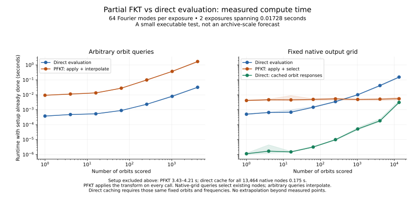

# Measured partial FKT versus direct evaluation

These plots measure the executable stage-aware transform, not a projected
runtime for the enormous unallocated eight-day or 30-day plans.



The workload uses the original near-domain box, two instantaneous exposures
spanning **0.01728 seconds**, bandwidth `|kx|, |ky| <= 1/ARCSEC`, and synthetic
Fourier coefficients. Both methods evaluate the same fields on the same orbit
queries. This is a small numerical regression, not an astronomical survey
benchmark. It does not measure detector-image preparation or pixel sampling.

## What the curves show

For **arbitrary queries**, PFKT must interpolate its root field. The present
implementation constructs a 13,464-entry stencil for every query. In the
64-mode-per-exposure case, 4,096 queries took 1.699 seconds after the root field
was ready, or about 1.703 seconds including transform application. Compiled
direct evaluation took 0.0320 seconds. No measured arbitrary-query count favored
PFKT, even when its setup was excluded.

For **native output-grid queries**, the transform already produces the requested
node values. It computes all 13,464 root values on every application, then selects
the requested subset. Its nearly flat curve is limited to this fixed grid:
extending it beyond 13,464 nodes would require another construction.

| Full native grid, geometry/compiler ready | 1 mode/exposure | 64 modes/exposure |
| --- | ---: | ---: |
| Fresh direct orbit and field evaluation | 62.2 ms | 154.5 ms |
| PFKT application and node selection | 3.96 ms | 5.48 ms |
| Direct application with those orbit responses cached | 0.0349 ms | 3.12 ms |
| PFKT planning and materialization, once | 4.35 s | 4.21 s |
| Direct response-cache construction, once | 0.0716 s | 0.1754 s |

The PFKT versus fresh-direct crossing first appears at the measured 1,024-node
point in both native-grid workloads. **That is not a first-use break-even point
or a win over cached direct evaluation.** The green curve gives direct evaluation
the same opportunity to reuse fixed geometry: precompute the response to each
Fourier coefficient at each requested orbit, then multiply by new coefficients.
This cache requires the same orbit queries and frequencies. Its storage grows
with the product of query count and coefficient count; the full 64-mode example
contains 1,723,392 complex entries.

These measurements establish neither an archive-scale speedup nor that every
future construction must have the same behavior. They identify the current
arbitrary-query stencil cost and distinguish transform application from setup.

## Setup, measurement, and numerical checks

- [Arbitrary-query plots](results/arbitrary/timing_comparison.svg) show both
  first-use totals and reuse costs for 1 and 64 modes per exposure. First-use
  curves sum measured phases, including planning and materialization for PFKT.
  Direct compiler startup is displayed separately from warmed direct execution.
- [Native-grid plots](results/native/native_grid_comparison.svg) include the
  cached direct baseline. The response cache is built separately for each tested
  subset. PFKT applies to the coefficient vector on every timed call; it does not
  substitute a cached output vector.
- Timings use five batches with calibrated repeats for short operations. Points
  are medians; shading shows observed minimum and maximum, not confidence
  intervals. Runs share a cloud host; these are local wall-clock measurements.
  BLAS/OpenMP/Numba thread limits are one. Versions and CPU quota are recorded
  in the arbitrary-query result.
- Direct evaluation uses the existing compiled all-conic Kepler/light-time
  solver and includes conversion from reception-chart coordinates. Arbitrary
  PFKT evaluation constructs fresh stencils in batches of 64; direct evaluates
  batches of 1,024. Query generation and imports are excluded for both methods.
- Every query-count/workload combination checks the full returned array against
  direct evaluation. The largest sampled discrepancy is `2.04e-14` per unit
  coefficient l1 norm, below the analytic interpolation bound of `6.54e-9`.
  These checks do not constitute a floating-point error certificate.
- Raw samples, single-run setup times, source hashes, and the actual plan are
  retained. No unmeasured orbit counts or large-domain runtimes are extrapolated.

## Reproduce

From the repository root, with the research dependencies and Matplotlib installed:

```bash
export OPENBLAS_NUM_THREADS=1 OMP_NUM_THREADS=1 MKL_NUM_THREADS=1 NUMBA_NUM_THREADS=1
python -m research.kepler_transform.timing.benchmark NEW_DIRECTORY/arbitrary
python -m research.kepler_transform.timing.native_grid NEW_DIRECTORY/native
python -m research.kepler_transform.timing.plot NEW_DIRECTORY/arbitrary
python -m research.kepler_transform.timing.plot_native NEW_DIRECTORY/native
python -m research.kepler_transform.timing.overview NEW_DIRECTORY
```

The scripts refuse to reuse an existing benchmark output directory. The overview
plots the 64-mode cases; the separate plots retain both workloads.
